# GIẢI PHÁP, CÔNG CỤ HỖ TRỢ & QUY TRÌNH SẢN XUẤT VIDEO `2D-ILLUSTRATED-HISTORY` DÀI 30+ PHÚT (CHỈ TỪ `KỊCH BẢN + VOICE`)

> **Nguyên tắc Báo cáo (Tuân thủ ``GURU.md`` — Ray Dalio & Charlie Munger):**
> Không vòng vo, không tô hồng. Cái gì tự động hóa được 100% nói rõ **LÀM ĐƯỢC** và giải thích tại sao; cái gì AI không tự làm 100% được hoặc sẽ bị lỗi khi kéo dài 30 phút nói thẳng **KHÔNG LÀM ĐƯỢC THEO CÁCH CŨ** và chỉ rõ giải pháp kỹ thuật thay thế.

---

## I. PHẢN BIỆN THẲNG THẮN: VỚI `KỊCH BẢN + VOICE 30 PHÚT`, CÁI GÌ LÀM ĐƯỢC & CÁI GÌ KHÔNG LÀM ĐƯỢC?

Một video dài **30 – 35 phút (`1,800 – 2,100 giây`)** theo nhịp của `Ziro History` (`~6 giây/cảnh`) sẽ cần khoảng **`300 – 350 phân cảnh`** và **`600 – 800 nhịp chuyển động nhỏ`**.

### 1. NHỮNG GÌ LÀM ĐƯỢC TỰ ĐỘNG `95% – 100%` (Chiếm ~75% thời lượng video 30 phút = ~22.5 phút)

| Hạng mục trong Video 30 Phút | Trạng thái | Tại sao khẳng định LÀM ĐƯỢC 95% – 100%? |
| :--- | :-: | :--- |
| **1. Nghe `Voice 30 phút` lấy mốc giây chính xác từng từ (`Word-level Timestamp`) & Nhép miệng Chú lính (`Lip-Sync`)** | ✅ **LÀM ĐƯỢC 100%** | Máy tính xử lý âm thanh 30 phút bằng thư viện **`faster-whisper` / `stable-ts`** kết hợp đo biên độ sóng âm **`RMS 30fps`** chỉ mất **90 giây**. Độ chính xác tới `0.02 giây`, dài 30 phút hay 2 tiếng đều không sai lệch. |
| **2. Nhóm cảnh Sân khấu xám `#CCCCCC` + Chú lính dẫn chuyện + Thẻ ảnh lịch sử thật + Đóng dấu `[YES]/[SURVIVED]` + Checklist `[✓]` + Bộ đếm số (`Counter`) + Lặp Icon (`20 củ tỏi`) + Chữ gõ `Typewriter` + Cuộn giấy 11 Chương (~50% video)** | ✅ **LÀM ĐƯỢC 100%** | Như đã chứng minh khi xem luồng `.mp4` của đối thủ: đây là **các Khuôn Mẫu Cố Định (`Parameterized Templates`)**. Chỉ cần truyền dữ liệu chữ/số/ảnh từ kịch bản vào khuôn là code tự động gõ chữ từng ký tự, nhảy số đếm, nhân bản icon thành hàng và đóng dấu khớp 100% với giọng đọc. |
| **3. Nhóm cảnh Bản đồ Vệ tinh Địa chính trị + Rọi đèn Spotlight + Tô màu Quốc gia + Mặt nạ Chiếm đóng (`Moving Frontline Clip-Mask`) + Mũi tên Tiến quân (~25% video)** | ✅ **LÀM ĐƯỢC 90% – 95%** | Biên giới các quốc gia và vùng lãnh thổ đã có sẵn tọa độ chuẩn trong kho dữ liệu mở **`Natural Earth GeoJSON` / `Historical-Basemaps`**. Code chỉ việc đọc tên nước trong kịch bản (`"North Korea"`, `"China"`, `"Japan"`), cắt đúng hình dáng đa giác quốc gia đó, phủ màu đỏ/xanh và cho mặt nạ trượt từ Bắc xuống Nam (như cảnh tiến quân xuống vòng vây Busan ở `clip_04`). |

---

### 2. NHỮNG GÌ KHÔNG LÀM ĐƯỢC NẾU DÙNG CÁCH THÔNG THƯỜNG (Chiếm ~25% thời lượng = ~7.5 phút) & LÝ DO TẠI SAO

| Hạng mục Điểm Nghẽn | Trạng thái nếu làm tự động mù quáng | Tại sao KHÔNG LÀM ĐƯỢC (Giải thích thẳng bản chất kỹ thuật)? |
| :--- | :-: | :--- |
| **Điểm nghẽn 0 (Quan trọng nhất — Theo Guru #6 Murch/Eisenstein/Ackoff): Đọc Kịch bản theo kiểu "Bốc từ khóa ghép ảnh" (`Keyword-Matching`) mà không có Bộ Dịch Ngữ Nghĩa Câu Chữ $\rightarrow$ Hình Ảnh (`Script-to-Visual Semantic Translator`)** | ❌ **KHÔNG LÀM ĐƯỢC (Sẽ ra video slide thuyết trình khô khan, mất sạch cái hồn của `Ziro History`)** | - Nếu kịch bản viết: *"Chính quyền vận hành đất nước như một công ty gia đình"* mà AI chỉ bắt từ khóa `"đất nước"` để hiện cái bản đồ thì **thất bại hoàn toàn về mặt đạo diễn**! Cái hay của `Ziro History` là dịch cụm ẩn dụ *"như một công ty gia đình"* thành **cửa hàng tạp hóa `KIM & SONS - since 1948`**. - Nếu kịch bản viết câu Nhân - Quả: *"Xem phim Hàn Quốc có thể khiến bạn bị tống vào trại giam"* mà AI hiện cả cái Tivi lẫn Nhà tù ngay từ giây đầu tiên thì **mất sạch tính bất ngờ (`Punchline Timing`)**! Nó bắt buộc phải bẻ câu thành 3 nhịp theo đúng giây đọc từng cụm từ (`00:39` hiện Tivi $\rightarrow$ `00:41` bắn Mũi tên $\rightarrow$ `00:42` đập Song sắt nhà tù). |
| **Điểm nghẽn 1: Bắt AI thiết kế và render cả cục 30 phút (`350 cảnh`) trong 1 lần chạy** | ❌ **KHÔNG LÀM ĐƯỢC (Chắc chắn sập hoặc suy giảm chất lượng)** | 1. **Tràn bộ nhớ ngữ cảnh LLM (`Context Degradation`):** Không một Model AI nào giữ được sự tỉ mỉ cho 350 phân cảnh liên tiếp trong 1 lần sinh JSON. Từ cảnh thứ 40 trở đi AI sẽ làm ẩu, bỏ sót chi tiết. 2. **Tắc nghẽn Render (`54,000 frames`):** Xuất 1 mạch 54,000 khung hình nếu lỗi ở phút 25 sẽ mất trắng từ đầu. |
| **Điểm nghẽn 2: Dùng Model Sinh Ảnh (`image-generator`) vẽ 100 tấm ảnh nguyên khối cho các cảnh nhân vật đối thoại (như cảnh *Hổ & Gấu trong hang* ở `clip_03`)** | ❌ **KHÔNG LÀM ĐƯỢC (Sẽ bị lệch nét vẽ & nhân vật bị "đơ" không nhép miệng/cử động tay được)** | 1. **Lệch phong cách (`Style Drift`):** Sinh 100 ảnh rời bằng AI thì ảnh số 1 ra nét vẽ phẳng `Ziro History`, nhưng ảnh số 30 lại biến thành nét hoạt hình 3D hoặc anime khác hẳn. 2. **Dính liền bộ phận (`Baked-in Static Image`):** Nếu AI sinh ra 1 bức ảnh con Hổ nguyên khối (miệng và tay dính liền vào thân), khi đưa vào video con Hổ sẽ **đứng đơ như tượng gỗ**, không thể mở/khép miệng theo từng câu thoại hay đổi tay cầm củ tỏi như video đối thủ được! |
| **Điểm nghẽn 3: Tự động vẽ bản đồ các trận đánh/chiến dịch nhỏ chưa có sẵn trong GeoJSON (VD: *Vòng vây Busan*, *Phòng tuyến sông Áp Lục*)** | ⚠️ **CHỈ TỰ ĐỘNG ĐƯỢC 70% (Cần bộ khung tọa độ vùng)** | Thư viện `GeoJSON` quốc tế có sẵn biên giới **Quốc gia** và **Tỉnh/Thành phố**, nhưng không có sẵn đường ranh giới của một "trận đánh quân sự ngẫu nhiên" nếu không quy đổi nó về tọa độ Bắc/Nam/Đông/Tây của quốc gia đó. |
| **Điểm nghẽn 4: Kịch bản đầu vào của người dùng viết toàn văn xuôi thông tin khô khan suông 30 phút, không có câu ẩn dụ hay đoạn hội thoại hài (`Sitcom Skit`)** | ⚠️ **VIDEO SẼ BỊ NHÀM CHÁN NẾU KHÔNG CÓ BƯỚC "ĐẠO DIỄN CHUYỂN NGỮ KỊCH BẢN"** | Trong `Ziro History`, sự hài hước (như cảnh Hổ & Gấu than thở *"Day 3: I can't feel my tongue"*) nằm **ngay trong câu chữ kịch bản và voice**. Nếu `Kịch bản + Voice` đầu vào của bạn là văn kể sử thuần túy không có thoại nhân vật, AI không thể tự bịa thêm giọng nói mới vào `Voice` đã thu sẵn, mà phải bù đắp bằng **Bong bóng thoại chữ (`Speech Bubbles`) / Nhãn chú thích hài hước trên hình (`Visual Gag Labels` như biển hiệu `KIM & SONS`, con dấu `[YES]`)**. |
| **Điểm nghẽn 5 (Mới phát hiện qua Thực chiến): Khoảng cách giữa "Câu văn xuôi dài 12s–20s trong Kịch bản" và "Nhịp biến đổi nhanh 1.8s/beat của `Ziro History`" + Lỗi tự vẽ hình học bằng code (`PIL.ImageDraw`)** | ❌ **THẤT BẠI THẢM HẠI ("ĐẤM VÀO MẮT NGƯỜI XEM") NẾU GOM CẢ CÂU DÀI THÀNH 1 CẢNH TĨNH HOẶC DÙNG CODE VẼ HÌNH HỌC** | 1. Nếu kịch bản có 1 câu dài 35–45 chữ (`14 giây` đọc) mà AI chỉ tạo `1 Beat = 1 Cảnh`, màn hình sẽ đứng đơ suốt 14 giây $\rightarrow$ Khán giả thoát video ngay lập tức! 2. Nếu dùng hàm vẽ hình học (`PIL.ImageDraw: rectangle, ellipse, polygon`) để tự vẽ bản đồ giả, tự vẽ ảnh lịch sử giả, tự ghép hình que làm nhân vật $\rightarrow$ Ra đồ họa rác rưởi như Paint! **Giải pháp bắt buộc:** Phải có thuật toán **Băm Câu Dài Thành Chuỗi `Micro-Beats (1.5s – 2.2s/nhịp)`** theo từng mệnh đề/danh từ, kết hợp **100% Ảnh lịch sử thật + Bản đồ vệ tinh thật + Đồ họa 2D chi tiết do AI (`image-generator`) sinh ra**! |

---

## II. GIẢI PHÁP KỸ THUẬT & CÁC BỘ CÔNG CỤ (TRONG KHO `00_KHO_SKILLS_VA_CONG_CU_QUOC_TE` & NGOÀI GITHUB) ĐỂ XỬ LÝ TRIỆT ĐỂ

Để giải quyết 5 điểm nghẽn trên và sản xuất được video **30+ phút**, chúng ta kết hợp **Kho Nội Bộ hiện có** với **5 Tư duy/Công cụ Mã nguồn mở**:

### 1. Khai thác từ Kho `00_KHO_SKILLS_VA_CONG_CU_QUOC_TE` (Đóng gói vào Kho Riêng của Editor)
1. **`1_hyperframes_heygen` (`cut-the-curve`, `seam-craft`, `sound-design`):**
   - Dùng cho quy tắc đồng bộ âm thanh (`SFX Pop/Whoosh/Stamp`) và nhịp cắt chuyển cảnh vi mô (`1.5s – 2.2s`).
2. **`2_remotion_official_skills` & `5_remotion_core_engine` + `6_awesome_opus5_5_videos`:**
   - Dùng kiến trúc **`Parameterized Scene Components` (Khuôn mẫu cảnh tham số hóa)** và cấu trúc **7-Tag XML** để xây dựng 8 Khuôn mẫu chuẩn của `Ziro History` (`Typewriter`, `Counter`, `IconGrid`, `Checklist`, `PhotoStamp`, `SpotlightMap`, `SplitScreen`, `ChapterScroll`).
3. **`7_pyCapCut_timeline_engine` (`pycapcut`):**
   - Dùng để đóng gói toàn bộ phân cảnh của video 30 phút thành **Project CapCut PC Đa Lớp (`draft_content.json`)**.

### 2. Bổ sung 5 Công cụ / Thư viện Mở Bên Ngoài Để Giải Quyết Bài Toán 30 Phút
1. **`faster-whisper` / `stable-ts` + Bộ Băm Nhịp Vi Mô (`Clause-to-MicroBeat Splitter`):**
   - **Giải quyết khâu Voice 30 phút & Băm nhịp `1.8s`:** Bóc tách chính xác mốc giây (`start`, `end`) của từng từ và tự động cắt các câu văn dài (`10s–20s`) tại các liên từ/dấu phẩy/cụm động từ thành các **`Micro-Beats` dài `1.5s – 2.5s`**.
2. **Bản đồ Vệ tinh Địa hình Thật (`Real Satellite Map Tiles`) + `Natural Earth GeoJSON`:**
   - **Giải quyết khâu Bản đồ Lịch sử:** Nền bản đồ bắt buộc là **Ảnh chụp vệ tinh Trái Đất thật độ phân giải cao** kết hợp dữ liệu tọa độ đa giác (`Polygon`) biên giới thật từ `Natural Earth GeoJSON`. Tuyệt đối cấm vẽ đa giác màu trơn giả tạo trên nền trống!
3. **Kho Ảnh Tư liệu Lịch sử Thật (`Wikimedia Commons API / Search Archival Photos`):**
   - **Giải quyết khâu Hiện vật & Nhân vật có thật:** Mọi địa danh, hiện vật khảo cổ (như *Khối trụ Cyrus*, *Phố Tehran 1970/1980*, *Kinh đô Persepolis*) bắt buộc tải ảnh chụp lịch sử thật 100%, đóng khung viền trắng bo góc.
4. **AI Sinh Đồ Họa Minh Họa Chi Tiết (`image-generator`) + `rembg` (Tách nền `PNG RGBA`):**
   - **Giải quyết khâu Bối cảnh & Nhân vật 2D:** Mọi bối cảnh 2D (cửa hàng, hang đá, lều tướng, cung điện) và nhân vật đều phải được vẽ bằng `image-generator` theo đúng Style Guide nhiều chi tiết của `Ziro History`, sau đó tách nền sạch 100% thành `PNG RGBA`.
5. **Kiến trúc "Con Rối Giấy Lắp Ghép (`Modular Paper-Doll Rig`)" + "Nhép Miệng Tách Vai (`Turn-Taking Lip-Sync`)":**
   - Tách riêng lớp Miệng (`Closed/Half/Open`), Mắt (`Open/Blink`), Tay cầm đạo cụ và điều khiển nhép miệng độc lập cho từng nhân vật trong các phân đoạn Skit đối thoại.

---

## III. ĐỒNG BỘ HÓA QUY TRÌNH SẢN XUẤT VIDEO 30+ PHÚT VỀ CHUẨN 4 GIAI ĐOẠN TINH GỌN (`GD1 -> GD4 — KHÔNG VẼ THÊM VIỆC`)

> **[🔄 Đã cập nhật đồng bộ với `00_NHAT_KY_LOG` & `03_DANH_GIA_SKILL`]:** Thống nhất hoàn toàn về **Dây chuyền 4 Giai đoạn (`GD1 -> GD4`) chạy cuốn chiếu theo từng Cụm (`60s–90s/batch`)**, loại bỏ các công cụ trung gian rườm rà (không làm bàn dựng HTML 2.500 dòng, không tách vụn từng bộ phận vào CapCut), tập trung 100% vào **Bảng Khớp Nối Minh Bạch + Engine Python `2x SSAA` (`2-Pass Camera` + `3-Layer Audio`) + Kiểm duyệt trực tiếp trên `.mp4`**:

```mermaid
flowchart TD
    IN["ĐẦU VÀO\n• kich_ban.txt + voice.mp3 (hoặc Sinh Voice Đa Vai)\n• Chia nhỏ xử lý cuốn chiếu từng Cụm (60s-90s / 25-32 Micro-Beats)"]
    
    GD1["GIAI ĐOẠN 1 (GD1): BÓC TÁCH VOICE, KHÓA ĐỘ LỆCH 0.000S & QUÉT ĐIỂM NGẮT HƠI\n• Đo khẩu hình mouth_states_30fps + Đệm mẫu âm thanh chính xác (concat_wavs_locked -> 0.000s drift)\n• Quét tự động khoảng ngắt hơi (>= 0.10s) trong từng file .wav để khóa mốc giây (bt) của từng vế câu\n• Đầu ra: 01a_voice_locked_timeline.json + 01b_subphrase_timestamps.md"]
    
    GD2["GIAI ĐOẠN 2 (GD2): BẢNG KHỚP NỐI ĐẠO DIỄN 4 CỘT & PHIẾU NGUYÊN LIỆU\n• Lập Bảng Khớp Nối Minh Bạch: (1) Lời thoại t0->t1 | (2) Mốc bt bật hình | (3) Lớp hiển thị World vs HUD | (4) Điểm nổ SFX/BGM\n• Từ khóa 1-4 chữ + Đóng dấu cao su (Stamp Slam), CẤM 100% hộp phụ đề Karaoke dưới đáy\n• Đầu ra: 02a_bang_khop_noi_dao_dien.md + 02b_phieu_dat_hang_nguyen_lieu.json"]
    
    GD3["GIAI ĐOẠN 3 (GD3): KHO NHÂN VẬT THƯƠNG HIỆU 2D (KHỚP CỔ 100%) & NGUYÊN LIỆU THẬT\n• Nhân vật Thương hiệu Giáo Sư Du Hành + 10 Nhân vật phụ: Bờ vai 1.6x đầu, cằm ngập sâu 14px vào cổ áo (0% hở cổ)\n• Tải Ảnh lịch sử thật 100% + Bản đồ vệ tinh thật (Esri World Imagery + GeoJSON) + Kho SFX/BGM\n• Đầu ra: Kho tài nguyên chuẩn hóa + 03a_asset_contact_sheet.png"]
    
    GD4["GIAI ĐOẠN 4 (GD4): RENDER 2 LỚP CAMERA + 3 LỚP ÂM THANH & KIỂM DUYỆT TRỰC TIẾP .MP4\n• Pass 1 (World Stage có Zoom/Pan + Cô lập vùng nhìn không cắt nửa người) + Pass 2 (HUD/Title vẽ sau khi Zoom -> 0% mất chữ)\n• Bộ trộn Âm thanh 3 Lớp tự động: Voice (0.000s) + Event-Driven SFX (pop/stamp/whoosh/slam đúng bt) + Dynamic BGM (-16dB/-9dB)\n• Kiểm duyệt Kép trực tiếp: Ảnh chụp đỉnh phóng to (Peak-Zoom Grid) + Mở xem trực tiếp file .mp4 bằng read_file"]

    IN --> GD1 --> GD2 --> GD3 --> GD4
```

### Tóm tắt 3 Ưu điểm Sống còn của Quy trình Tinh Gọn V2 này:
1. **Không vẽ thêm việc, không qua trung gian rườm rà:** Không mất công duy trì 2 bộ code (Python + HTML), không sợ lệch khớp miệng khi đưa vào CapCut; người dùng theo dõi trực tiếp qua **Bảng Khớp Nối 4 Cột** và xem kết quả thật trên `.mp4`.
2. **Triệt tiêu 100% lỗi "mất chữ, cắt người khi zoom" và "lệch tiếng":** Nhờ kiến trúc **Vẽ 2 Lớp (`World Layer` tách biệt `HUD Layer`)** và thuật toán **`concat_wavs_locked` (`0.000s` drift) + Quét ngắt hơi trong câu**.
3. **Đầy đủ cảm xúc Điện ảnh (`50% linh hồn từ Âm thanh`):** Mọi chuyển động bật hình, đóng dấu, lia máy, tắt đèn, sập song sắt đều tự động nổ tiếng `SFX` khớp đến từng mili-giây trên nền nhạc `BGM` có `Auto-Ducking`.
