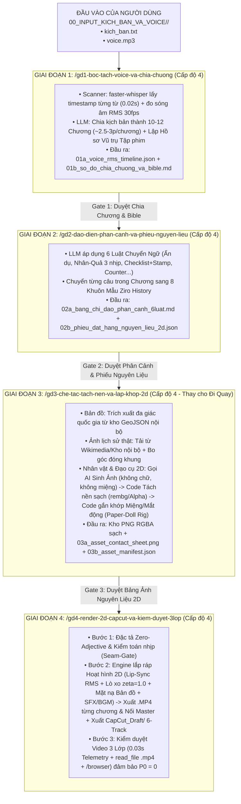

# BÁO CÁO KIỂM TOÁN SKILL HIỆN TẠI & KẾ HOẠCH KIẾN TRÚC DÂY CHUYỀN 4 GIAI ĐOẠN CHO `2D-ILLUSTRATED-HISTORY` (CHUẨN `PLAYBOOK-SKILL-CREATOR` & `9 GURU`)

> **Hệ quy chiếu đánh giá (`[ĐÃ XÁC MINH 100%]`):**
> 1. **[`playbook-skill-creator`](../../playbook-skill-creator/SKILL.md)** & Script kiểm toán toán học **[`validate_skill_structure.py`](../../playbook-skill-creator/scripts/validate_skill_structure.py)**.
> 2. **[`GURU.md`](../../../GURU.md)** (6 Guru Nội bộ) & **[`e:\02_CHANNEL\lifestyle-vlog\Du-an-lifestyle-vlog\GURU.md`](file:///e:/02_CHANNEL/lifestyle-vlog/Du-an-lifestyle-vlog/GURU.md)** (9 Guru Thực chiến & Kiến trúc Dây chuyền `gd1` $\rightarrow$ `gd5`).
> 3. **[`GIẢI PHẪU TOÀN BỘ CÁC LOẠI CẤU TRÚC & FILE TRONG KHO.md`](../../../00_KHO_SKILLS_VA_CONG_CU_QUOC_TE/GIẢI%20PHẪU%20TOÀN%20BỘ%20CÁC%20LOẠI%20CẤU%20TRÚC%20&%20FILE%20TRONG%20KHO.md)** & **[`01_PHAN_TICH_CAU_TRUC_SKILL_DOI_THU_QUOC_TE.md`](../../../00_KHO_SKILLS_VA_CONG_CU_QUOC_TE/01_PHAN_TICH_CAU_TRUC_SKILL_DOI_THU_QUOC_TE.md)**.

---

## PHẦN 1: NHÌN THẲNG SỰ THẬT — ĐÁNH GIÁ SKILL HIỆN TẠI (`dung-video-lich-su-hoat-hinh-2d`)

### 1.1. Kết quả chạy máy kiểm toán `validate_skill_structure.py` (`[📊 Đã xác minh bằng số liệu]`)
Khi chạy trực tiếp `python playbook-skill-creator/scripts/validate_skill_structure.py` lên thư mục [`.agent/skills/dung-video-lich-su-hoat-hinh-2d`](../../.agent/skills/dung-video-lich-su-hoat-hinh-2d/SKILL.md), hệ thống trả về **`Exit Code 1 [FAIL]` với 8 Lỗi Kiến trúc & 3 Cảnh báo Rỗng Ruột**:

| STT | Hạng mục Kiểm toán | Kết quả thực tế trên Skill hiện tại | Nguyên nhân gốc rễ (Theo `playbook-skill-creator` & `Guru #9 Karpathy/Anthropic`) |
| :-: | :--- | :--- | :--- |
| **1** | **Bệnh "Rỗng Ruột" ở `references/`** | ⚠️ **CẢNH BÁO ĐỎ (Cả 3 file chỉ dài 13–14 dòng)** | `01_giai_phau_6_lop...md` (14 dòng), `02_bo_nhan_vat...md` (14 dòng), `03_xuat_mp4...md` (13 dòng) chỉ viết gạch đầu dòng mô tả sơ sài; **hoàn toàn thiếu Bảng quyết định `Nếu X -> Thì Y`, thiếu cặp đối chứng `✅ Đúng / ❌ Sai`, thiếu đầu mục `## Mục`**. |
| **2** | **File `references/` mồ côi & Thiếu Lệnh đọc phẫu thuật** | ❌ **[FAIL] 6/8 Lỗi** | Trong `SKILL.md` không hề có lệnh trỏ đọc sang 3 file `references/` theo tọa độ dòng (`StartLine -> EndLine`). Khi chạy, AI bỏ qua hoàn toàn thư mục `references/`. |
| **3** | **Thiếu hoàn toàn thư mục `templates/` (Pure Output Schema)** | ❌ **[FAIL] Kiến trúc** | Không có khuôn mẫu JSON/Markdown chuẩn cho `Bảng Chỉ đạo Phân cảnh`, `Danh mục Nguyên liệu cần sinh` hay `Biên bản Kiểm duyệt`. |
| **4** | **Bản chất Code hiện tại là "Đóng đinh cho 1 đoạn Demo 94 giây" (`Hardcoded Demo`)** | ❌ **LỖI BẢN CHẤT NGHIÊM TRỌNG NHẤT** | Trong `SKILL.md` và `scripts/`, các cảnh như `KIM_AND_SONS_STOREFRONT`, `RADIO_ROOM_STAGE`, `WHALES_AND_SHRIMP_SEQUENCE` đang bị **viết cứng (`hardcode`) cho riêng bài Bắc Triều Tiên**! Nếu ngày mai bạn đưa vào `Kịch bản + Voice` về **Đế chế Mông Cổ** hay **Chiến tranh Việt Nam**, skill hiện tại **KHÔNG THỂ CHẠY ĐƯỢC** vì nó không có quy trình phân tích kịch bản mới và sinh nguyên liệu mới! |
| **5** | **Gom cả một dây chuyền phức tạp vào 1 Skill duy nhất** | ❌ **SAI KIẾN TRÚC DÂY CHUYỀN** | Giống như bạn đã nhận ra ở [`e:\02_CHANNEL\lifestyle-vlog`](file:///e:/02_CHANNEL/lifestyle-vlog): từ lúc nhận `Kịch bản + Voice` (dài 15–35 phút) đến lúc ra video hoàn chỉnh phải qua **nhiều giai đoạn bản chất khác nhau** (Bóc tách âm thanh $\rightarrow$ Đạo diễn chuyển ngữ kịch bản sang phân cảnh $\rightarrow$ Tìm/Vẽ/Tách nền/Lắp khớp nguyên liệu 2D $\rightarrow$ Dựng & Kiểm duyệt). Nhồi tất cả vào 1 skill 51 dòng là **bất khả thi**. |

---

## PHẦN 2: SO SÁNH BẢN CHẤT `LIFESTYLE-VLOG` VS. `2D-ILLUSTRATED-HISTORY` — TẠI SAO PHẢI TÁCH THÀNH DÂY CHUYỀN NHIỀU GIAI ĐOẠN?

Nhận định của bạn **chính xác 100% về mặt Tư duy Hệ thống**:
Ở [`e:\02_CHANNEL\lifestyle-vlog`](file:///e:/02_CHANNEL/lifestyle-vlog), chúng ta có **GĐ 2 (Chỉ đạo quay) $\rightarrow$ GĐ 3 (Đi quay thực địa lấy nguyên liệu thô) $\rightarrow$ GĐ 4 (Kiểm định nguyên liệu & Chỉ đạo dựng) $\rightarrow$ GĐ 5 (Dựng phim & Kiểm duyệt 3 lớp)**.

Sang **`2D-Illustrated-History`** (khi đầu vào của bạn là **`Kịch bản + Voice`** có sẵn), chúng ta **không cầm máy ảnh đi quay ngoài đời**, nhưng bản chất vật lý của **Giai đoạn "Đi Quay" (GĐ 3)** được thay thế hoàn toàn bằng **Giai đoạn "Săn Tìm, Sinh Ảnh/Video AI, Tách Nền & Đóng Khớp Con Rối 2D (`Asset Forge & Paper-Doll Rigging`)"**!

### Bảng Đối Chiếu Bản Chất Giữa 2 Hệ Thống:

| Mắt xích Dây chuyền | Bên `Lifestyle Vlog` (Quay Đời Thực) | Bên `2D-Illustrated-History` (Đầu vào: `Kịch bản + Voice`) |
| :--- | :--- | :--- |
| **Đầu vào khởi điểm** | Ý tưởng chủ đề $\rightarrow$ Đi quay $\rightarrow$ Thu Voice sau. | **Đã có sẵn `kich_ban.txt` + `voice.mp3` (dài 10 – 35 phút).** |
| **Giai đoạn 1 (`GD1`)** | Đạo diễn Ý tưởng & Bao bì. | **Bóc tách Âm thanh (`Voice Alignment`), Chia Chương (`10–12 Chapters`) & Lập Hồ Sơ Vũ Trụ Tập Phim (`Episode Bible`)**: Nghe `voice.mp3` lấy mốc giây từng từ (`0.02s`), đo sóng âm `RMS 30fps` cho chú lính nhép miệng, chia kịch bản dài 30 phút thành 10–12 Chương (~2.5 phút/chương) và lập danh sách các Quốc gia, Nhân vật lịch sử, Đạo cụ xuyên suốt tập phim. |
| **Giai đoạn 2 (`GD2`)** | Kịch bản sơ bộ & Phiếu bấm máy hiện trường (`02b`, `02c`). | **Đạo diễn Chuyển ngữ Kịch bản $\rightarrow$ Hình ảnh (`6 Luật Chuyển Ngữ`) & Xuất Phiếu Đặt Hàng Nguyên Liệu (`Asset Order Sheet`)**: Đi từng Chương, dịch từng câu chữ trong kịch bản sang **8 Khuôn Mẫu Ziro History** (`Typewriter/Counter`, `Cause->Effect`, `Checklist+Stamp`, `Literal Visual Gag`, `Spotlight Map`, `Split-Screen`, `Paper-Doll Sitcom`, `Chapter Scroll`) và liệt kê chính xác **những bức ảnh/bản đồ/con rối nào cần phải tìm hoặc vẽ mới**. |
| **Giai đoạn 3 (`GD3`)** | Cầm máy đi quay thực địa (`raw_videos/`, `raw_thumbs/`). | **Nhà Máy Chế Tác, Tách Nền & Lắp Khớp Nguyên Liệu 2D (`Asset Acquisition, AI Generation, Background Removal & Paper-Doll Rigging`)**: Không đi quay, mà dùng: (1) Code trích xuất đa giác Bản đồ `GeoJSON`, (2) Code tải ảnh chân dung lịch sử thật (`Wikimedia`), (3) Gọi AI Sinh Ảnh (`image-generator`) vẽ nhân vật/đạo cụ 2D viền đen `4px` $\rightarrow$ Chạy thuật toán **Tách nền sạch 100% (`rembg` / Alpha Matte)** $\rightarrow$ **Gắn lớp Miệng động (`mouth_open/closed`) & Mắt chớp (`eyes_blink`)** $\rightarrow$ Kiểm duyệt lưới ảnh nguyên liệu! |
| **Giai đoạn 4 (`GD4`)** | Lắp ráp đa lớp, xuất `.MP4` + `CapCut_Draft/` & Kiểm duyệt 3 lớp (`gd5`). | **Lắp Ráp Hoạt Hình 2D Theo Từng Chương (`Spring Physics + Lip-Sync + Camera Pan`), Xuất Kép `.MP4` + `CapCut_Draft/` & Kiểm Duyệt Video 3 Lớp**: Render từng chương (~3 phút/chương), kiểm duyệt bằng Cơ chế Đọc Video 3 Lớp (`0.03s Telemetry` + `read_file .mp4` + `/browser`), nối thành Master 30 phút và xuất Project CapCut PC 6-Track! |

---

## PHẦN 3: PHÂN ĐỊNH RẠCH RÒI — CÁI GÌ AI & CODE LÀM TỐT, CÁI GÌ AI LÀM KHÔNG TỐT, VÀ CON NGƯỜI CẦN LÀM GÌ?

Tuân thủ **Guru #2 Ray Dalio (Minh bạch tuyệt đối — không tô hồng)** và **Guru #9 Andrej Karpathy (`Software 1.0 Code` vs `Software 2.0 LLM` vs `Con người`)**, đây là ranh giới thực tế nhất:

### 1. Những gì `CODE PYTHON (Software 1.0)` làm TỐT TUYỆT ĐỐI (100% Tự động & Chính xác Toán học)
1. **Đo âm thanh & Nhép miệng (`Audio Alignment & RMS Lip-Sync`):** Bóc tách mốc giây từng từ trong file `voice.mp3` dài 35 phút bằng `faster-whisper`, tính biên độ âm lượng `RMS` ở từng khung hình (`1/30s`) để điều khiển miệng chú lính đóng/mở (`closed / half / open`) khớp 100% giọng đọc mà không bao giờ lệch 1 mili-giây.
2. **Dựng 5/8 Khuôn mẫu Đồ họa Tham số hóa (`Parameterized Motion Templates`):**
   - Gõ chữ `Typewriter` từng ký tự + Nhảy số đếm `Number Counter` (`1 -> 26,000,000`).
   - Nhân bản 1 icon thành lưới `Icon Grid Repeater` (`20 củ tỏi`, `100 ngày`) bật nảy theo phương trình lò xo `Critically Damped Spring (zeta = 1.0)`.
   - Bảng `Checklist [✓]` + Đóng dấu `[YES]/[DENIED]` lên khung ảnh lịch sử.
   - Sơ đồ Nhân - Quả 3 nhịp (`Trái -> Mũi tên -> Phải`) bật đúng mốc giây của từng vế câu.
   - Cuộn giấy cổ 11 Chương (`Chapter Scroll`) và Chia đôi màn hình (`Split-Screen`).
3. **Vẽ Bản đồ Địa chính trị từ Kho Tọa độ (`GeoJSON Territory & Moving Frontline`):** Tự động lấy tọa độ biên giới quốc gia từ kho `Natural Earth GeoJSON`, rọi đèn `Spotlight`, tô màu đỏ/xanh và trượt mặt nạ chiếm đóng (`Moving Clip-Mask`).
4. **Tách nền tự động & Đóng gói Project CapCut PC (`rembg` + `pycapcut`):** Tự động xóa phông trắng/xanh của ảnh AI thành `PNG RGBA` trong suốt và biên dịch toàn bộ 350 cảnh thành file dự án `draft_content.json` mở trực tiếp trên CapCut PC.

### 2. Những gì `NÃO AI (LLM + Vision)` làm TỐT (85% – 90%)
1. **Đạo diễn Chuyển ngữ Kịch bản (`6-Rule Semantic Script Translator`):** Đọc từng câu trong `kich_ban.txt` và phân loại xem câu này nên dùng **Ẩn dụ nghĩa đen (Luật 1)**, **Sơ đồ Nhân - Quả 3 nhịp (Luật 2)**, **Checklist + Đóng dấu (Luật 3)**, **Đếm số/Nhân bản Icon (Luật 4)** hay **Đổi trạng thái Sáng/Tối (Luật 5)**.
2. **Viết Prompt sinh ảnh đồng nhất phong cách (`Style-Locked Prompting`):** Tự động chuyển yêu cầu đạo cụ (VD: *"Cửa hàng KIM & SONS"*, *"Con cá voi Trung Quốc"*, *"Chiếc xe tăng T-34"*) thành câu lệnh Prompt chuẩn nét vẽ phẳng viền đen `4px` kiểu `Ziro History` để gọi công cụ sinh ảnh.
3. **Kiểm duyệt bằng Mắt Thần (`Multimodal QA via read_file`):** Nhìn bảng lưới ảnh nguyên liệu (`Asset Contact Sheet`) để phát hiện ảnh nào bị lỗi tách nền, lệch nét vẽ; và xem trực tiếp luồng `.mp4` để bắt lỗi đứng hình hay lệch chữ.

### 3. Những gì AI làm KHÔNG TỐT (Điểm Yếu Chí Mạng Cần Tránh)
1. ❌ **AI Sinh Ảnh (`image-generator`) KHÔNG THỂ vẽ chữ chính xác 100% và KHÔNG THỂ tách sẵn các bộ phận cử động (Miệng, Mắt, Tay rời):**
   - Nếu bảo AI sinh ảnh vẽ biển hiệu `"KIM & SONS - since 1948"` hay bảng `"Kim's promises"`, AI thường viết sai chính tả hoặc nhòe chữ.
   - **Giải pháp kỹ thuật bắt buộc:** AI chỉ được phép vẽ **Khung cảnh / Thân nhân vật / Đạo cụ KHÔNG CÓ CHỮ và KHÔNG CÓ MIỆNG** (`Blank Signage / Mouthless Body`). Mọi dòng chữ trên biển hiệu, nhãn tên (`CHINA`, `USA`) và **Lớp Miệng đóng/mở (`mouth_open/closed.png`)** bắt buộc phải do **Code Python (`Pillow/Cairo`) ghép đè lên trên** với tọa độ chính xác!
2. ❌ **AI KHÔNG THỂ giữ sự tập trung nếu bắt xử lý cả kịch bản 30 phút (`350 cảnh`) trong 1 lần chạy:**
   - Nếu nạp cả 5.000 từ vào 1 lượt, từ phút thứ 5 trở đi AI sẽ cắt bớt cảnh và làm ẩu.
   - **Giải pháp kỹ thuật bắt buộc:** Phải cắt thành **10 – 12 Chương (`~2.5 – 3 phút/chương = ~25 cảnh/chương`)** ở Giai đoạn 1, rồi chạy cuốn chiếu từng Chương qua GĐ 2 $\rightarrow$ GĐ 3 $\rightarrow$ GĐ 4.
3. ❌ **AI KHÔNG THỂ tự bịa ra lời thoại hài hước bằng giọng nói nếu file `Voice` đã thu âm đóng đinh:**
   - Nếu kịch bản gốc khô khan, AI không thể sửa file `voice.mp3` của bạn, mà chỉ có thể thêm **Bong bóng thoại chữ (`Speech Bubbles`)** hoặc **Biển hiệu châm biếm (`Visual Gag Signs`)** trên hình.

### 4. CON NGƯỜI Cần Làm Gì Trong Quy Trình Này? (4 Điểm Chạm Chiến Lược — Tốn ~15–20 Phút/Video 30 Phút)
Thay vì phải ngồi vẽ và kéo thả 350 cảnh mất 40 tiếng đồng hồ, con người chỉ đóng vai trò **"Tổng Đạo Diễn Duyệt Cổng (`Human-in-the-Loop Gatekeeper`)"** tại 4 điểm chạm:
1. **Đầu vào:** Cung cấp `kich_ban.txt` + `voice.mp3` (Nếu ngay từ lúc viết kịch bản, người viết cài sẵn vài câu ví von kiểu *"như công ty gia đình"* hoặc 1–2 đoạn hội thoại ngắn như *Hổ & Gấu* thì video sẽ đạt 100% độ duyên của `Ziro History`).
2. **Tại Cổng Duyệt GĐ 2 (`Gate 2` — Duyệt Kịch bản Phân cảnh & Ý tưởng Ẩn dụ):** Đọc lướt bảng phân cảnh AI vừa dịch từ kịch bản xem các hình ảnh ẩn dụ AI đề xuất (VD: vẽ cửa hàng tạp hóa, vẽ con tôm kẹp giữa cá voi) đã đủ sắc sảo chưa; nếu muốn đổi ý tưởng hình ảnh nào chỉ cần gõ 1 dòng chỉ đạo.
3. **Tại Cổng Duyệt GĐ 3 (`Gate 3` — Duyệt Bảng Nguyên Liệu 2D trước khi Render):** Nhìn 1 tấm ảnh lưới (`Asset Contact Sheet`) chứa toàn bộ các nhân vật/đạo cụ AI vừa tìm/vẽ và tách nền cho Chương đó. Thấy tấm nào chưa ưng mắt thì bảo AI vẽ lại đúng tấm đó (mất 10 giây) trước khi đưa vào lắp ráp video.
4. **Tại Cuối GĐ 4 (Tinh chỉnh Hậu kỳ trên CapCut PC — Nếu cần):** Mở dự án `CapCut_Draft/` đã được xếp sẵn 6 Track trên CapCut PC để xem lướt 60fps, chỉnh lại vị trí hoặc thêm thắt hiệu ứng theo gu cá nhân trong 5–10 phút rồi xuất file!

---

## PHẦN 4: KẾ HOẠCH KIẾN TRÚC HOÀN CHỈNH — TỔ CHỨC LẠI `2D-ILLUSTRATED-HISTORY` THÀNH HỆ SINH THÁI 4 GIAI ĐOẠN (CHUẨN CẤP ĐỘ 4 `PLAYBOOK-SKILL-CREATOR`)

Áp dụng đúng cấu trúc Dây chuyền Hợp đồng File trên ổ cứng (`File-System State Contracts`) của [`e:\02_CHANNEL\lifestyle-vlog`](file:///e:/02_CHANNEL/lifestyle-vlog) và tiêu chuẩn **Cấp độ 4 (`Enterprise Hybrid Engine: Scanners -> LLM -> Engines -> Validators`)** của [`playbook-skill-creator`](../../playbook-skill-creator/SKILL.md):

### 4.1. Sơ Đồ Luồng Chạy 4 Giai Đoạn & Các File Hợp Đồng Bàn Giao Trên Ổ Cứng



---

### 4.2. Cấu Trúc Thư Mục Dự Án & 4 Bộ Skill Chuẩn `validate_skill_structure.py [PASS 100%]`

```text
e:\02_CHANNEL\thu-nghiem\edit-video\2D-Illustrated-History\
├── GURU_2D_HISTORY.md                                      ← Hiến pháp 9 Guru + 6 Luật Chuyển Ngữ Kịch bản <-> Hình ảnh
├── log-tap-phim.md                                         ← Sổ theo dõi trạng thái từng tập (EP001: GD1_DONE -> GD4_DONE)
│
├── 00_INPUT_KICH_BAN_VA_VOICE/                             ← [ĐẦU VÀO NGƯỜI DÙNG BỎ VÀO ĐÂY]
│   └── EP001/
│       ├── kich_ban.txt
│       └── voice.mp3
├── 01_GD1_Boc-tach-Voice-va-Chia-chuong/EP001/             ← Hợp đồng GĐ 1 (01a_voice_rms.json, 01b_chia_chuong_bible.md)
├── 02_GD2_Dao-dien-Phan-canh-va-Phieu-nguyen-lieu/EP001/   ← Hợp đồng GĐ 2 (02a_phan_canh.md, 02b_phieu_nguyen_lieu.json)
├── 03_GD3_Kho-nguyen-lieu-2D-da-tach-nen/EP001/            ← Hợp đồng GĐ 3 (props_rgba/, maps/, photos/, 03a_contact_sheet.png)
├── 04_GD4_Thanh-pham-MP4-va-CapCut-Draft/EP001/            ← Thành phẩm GĐ 4 (EP001_final.mp4, CapCut_Draft/, 04c_audit_3lop.md)
│
└── .agent/skills/                                          ← 4 BỘ SKILL DÂY CHUYỀN CẤP ĐỘ 4 (Đạt chuẩn PASS 100% validate_skill_structure.py)
    ├── _kho_rieng_dung_chung_2d_history/                   ← Pháo đài Tự chủ: Chứa pycapcut, GeoJSON, Font, SFX, Host Soldier Kit
    ├── gd1-boc-tach-voice-va-chia-chuong/
    │   ├── SKILL.md                                        (≤ 130 dòng, Lệnh đọc phẫu thuật StartLine-EndLine)
    │   ├── references/                                     (Ruột đặc: Bảng quyết định chia chương, chuẩn RMS 30fps, ✅/❌)
    │   ├── templates/                                      (Pure Output Schema cho 01b_so_do_chia_chuong_va_bible.md)
    │   └── scripts/ (scanners/, engines/, validators/)
    ├── gd2-dao-dien-phan-canh-va-phieu-nguyen-lieu/
    │   ├── SKILL.md                                        (≤ 130 dòng, Điều phối 6 Luật Chuyển Ngữ & 8 Khuôn Mẫu)
    │   ├── references/                                     (Ruột đặc: Bảng 6 Luật Chuyển Ngữ, Thông số 8 Khuôn mẫu, ✅/❌)
    │   ├── templates/                                      (Pure Output Schema cho 02a_bang_phan_canh & 02b_phieu_nguyen_lieu)
    │   └── scripts/ (scanners/, engines/, validators/)
    ├── gd3-che-tac-tach-nen-va-lap-khop-2d/
    │   ├── SKILL.md                                        (≤ 130 dòng, Điều phối Săn tìm, AI Sinh ảnh, Tách nền, Lắp khớp miệng)
    │   ├── references/                                     (Ruột đặc: Luật Prompt viền đen 4px không chữ, ngưỡng tách nền RGBA, Rigging)
    │   ├── templates/                                      (Pure Output Schema cho 03b_danh_muc_nguyen_lieu_da_rig.md)
    │   └── scripts/ (scanners/, engines/, validators/)     (Gồm: fetch_geojson_map.py, remove_bg_and_rig_mouth.py, build_contact_sheet.py)
    └── gd4-render-2d-capcut-va-kiem-duyet-3lop/
        ├── SKILL.md                                        (≤ 130 dòng, Điều phối Bước 1 Spec -> Bước 2 Render/CapCut -> Bước 3 Audit 3 lớp)
        ├── references/                                     (Ruột đặc: Zero-Adjective Spec, Spring zeta=1.0, Audit P0/P1)
        ├── templates/                                      (Pure Output Schema cho 04a_spec.md, 04b_render.md, 04c_audit_3lop.md)
        └── scripts/ (scanners/, engines/, validators/)     (Gồm: render_2d_chapter_and_capcut.py, audit_video_3layer.py, validate_gd4.py)
```

---

## PHẦN 5: 8 LỆNH CẤM TUYỆT ĐỐI (`ZERO-TOLERANCE ANTI-PATTERNS` ĐÚC KẾT TỪ THỰC CHIẾN V1 & V2) & KIẾN TRÚC "KHÔNG VẼ THÊM VIỆC"

> **[🚨 BÀI HỌC XƯƠNG MÁU BẮT BUỘC KHÓA CỨNG VÀO VALIDATOR CỦA 4 SKILL (`GD1 -> GD4`)]:**
> Qua quá trình thực chiến từ bản V1 đến bản V2 Ziro Master (`Cụm A` & `Cụm B`), hệ thống bắt buộc phải cưỡng chế bằng code kiểm định (`validator`) **8 Lệnh Cấm Tuyệt Đối** và **Nguyên tắc Tinh Gọn Không Vẽ Việc** sau:

### 5.1. Nguyên Tắc Tối Thượng: "Không Vẽ Thêm Việc — Không Qua Trung Gian Rườm Rà"
1. ❌ **KHÔNG bê bàn dựng Web `index.html` 2.500 dòng sang dự án 2D:** Vì dự án 2D dùng **Engine Đồ họa Python `2x SSAA`** vẽ trực tiếp nhân vật nhép miệng `30fps` và vật lý lò xo, việc làm thêm bàn dựng HTML là bắt bảo trì 2 bộ code song song vô ích.
2. ❌ **KHÔNG tách vụn từng bộ phận (đầu, miệng, tay, con dấu) ra hàng chục Track trong `CapCut PC`:** Kéo lệch 1 frame trong CapCut sẽ làm đầu lìa khỏi cổ, miệng lệch khỏi tiếng. Chỉ xuất các file `.mp4` thành phẩm nét căng đã trộn đủ 3 lớp âm thanh (hoặc xuất từng câu `beat_XX.mp4` sạch nếu cần ghép hậu kỳ).
3. ✅ **Theo dõi minh bạch 100% bằng "Bảng Khớp Nối Đạo Diễn (`Director Sync Sheet`)" + "Đọc Trực Tiếp Video `.mp4` & Ảnh Chụp Đỉnh Phóng To (`Peak-Zoom Grid`)":** Trước và sau khi dựng mỗi cụm, người dùng nắm trọn kịch bản qua Bảng Khớp Nối 4 cột (*Lời thoại `t0->t1`* | *Mốc giây `bt` bật hình* | *Góc Camera & Lớp hiển thị `World` vs `HUD`* | *Điểm nổ `SFX + BGM`*).

### 5.2. 8 Lệnh Cấm Tuyệt Đối (`8 Hard Gates`) Trong Code & Skill

1. **LỆNH CẤM 1 (Tại `GD3` — Cấm Vẽ Hình Học Sơ Sài Giả Tạo & Cấm Hở Khớp Cổ Nhân Vật):**
   - **CẤM TUYỆT ĐỐI** vẽ bản đồ giả bằng đa giác méo mó hoặc tự vẽ ảnh lịch sử giả! Bản đồ phải là **Ảnh Vệ Tinh Địa Hình Thật (`Esri World Imagery` + `GeoJSON`)**, tư liệu phải là **Ảnh Chụp Lịch Sử Thật 100%**.
   - **Quy chuẩn Nhân vật Thương hiệu V2 (`2x SSAA Vector Puppet`):** Sử dụng **Giáo Sư Du Hành (`mascot_time_traveler`)** + bộ nhân vật lịch sử chuyên biệt. Bắt buộc tuân thủ giải phẫu liền khối: **Bờ vai rộng gấp `1.6x` chiều ngang đầu (`104px` vs `70px`)** và **tâm đầu hạ thấp để đáy cằm ngập sâu `14px` vào cổ áo chữ V (`head_cy = sh_y - head_ry + 14`)**, xóa sổ 100% lỗi đầu lìa khỏi cổ.

2. **LỆNH CẤM 2 (Tại `GD1 & GD2` — Cấm Để 1 Câu Văn Dài Đứng Im Trên 1 Cảnh Quá `3.0 Giây`):**
   - **CẤM TUYỆT ĐỐI** gán `1 câu văn dài (10s – 20s) = 1 Beat tĩnh`!
   - **Quy chuẩn bắt buộc (`Micro-Beat Decomposition`):** Mọi câu kịch bản dài quá `3.5 giây` bắt buộc phải được băm theo từng cụm Danh từ / Động từ / Mệnh đề thành chuỗi **`Micro-Beats` (`1.5s – 2.2s / nhịp`)**. Một đoạn video `60 giây` bắt buộc phải có từ **`25 đến 32 Micro-Beats`**.

3. **LỆNH CẤM 3 (Tại `GD2 & GD4` — Cấm Hộp Phụ Đề Karaoke Dưới Đáy Màn Hình):**
   - **CẤM TUYỆT ĐỐI** vẽ hộp đen dưới đáy màn hình chép lại cả câu văn dài!
   - **Quy chuẩn bắt buộc (`Kinetic / Typewriter Callout Text & Stamp Slam`):** Chỉ hiển thị **Từ khóa Đạo diễn ngắn gọn (`1 – 4 từ`)** có dấu tiếng Việt sắc nét (`Segoe UI Bold`) bằng hiệu ứng **Gõ chữ (`Typewriter`)** hoặc **Đóng dấu cao su (`Stamp Slam`)** kèm rung chấn màn hình (`Screen Shake`) đúng thời điểm giọng đọc nhấn trọng âm.

4. **LỆNH CẤM 4 (Tại `GD4` — Cấm Khung Hình Đứng Yên `Static Camera`):**
   - **CẤM TUYỆT ĐỐI** để khung hình đứng im (`scale = 1.0`, `x = 0, y = 0`) suốt câu thoại.
   - **Quy chuẩn bắt buộc:** Mọi cảnh đều phải có **Chuyển động Camera có chủ đích (`Slow Push-in 1.00x -> 1.08x`, `Fast Zoom-to-Target`, `Whip-Pan`, `Screen Shake` khi đóng dấu)** kết hợp chuyển động lò xo (`EaseOutBack / Critically Damped Spring`).

5. **LỆNH CẤM 5 (Tại Toàn Quy Trình — Cấm Làm Ẩu Tràn Lan 5 Phút Trong 1 Lần Chạy):**
   - **CẤM TUYỆT ĐỐI** ôm đồm làm một lúc 5 phút (`300 giây`) khiến mỗi cảnh bị rỗng chi tiết.
   - **Quy chuẩn bắt buộc (`60-Second High-Density Batch`):** Sản xuất và kiểm duyệt cuốn chiếu **từng cụm `60 – 90 giây` (`25 – 32 Micro-Beats/cụm`)**.

6. **LỆNH CẤM 6 (Tại `GD1 & GD4` — Cấm Lệch Nhịp Giọng Đọc & Hình Ảnh `Audio-Visual Drift > 0.000s`):**
   - **CẤM TUYỆT ĐỐI** ghép các file `.wav` mà bỏ quên khoảng nghỉ `pause_after` trong `mouth_states_30fps`, hoặc đặt mốc bật hình `bt` sớm hơn thời điểm người dẫn chuyện đọc tới từ khóa đó!
   - **Quy chuẩn bắt buộc (`0.000s Drift Lock & Syllable-Locked Triggers`):**
     - Dùng hàm `concat_wavs_locked()` đệm mẫu âm thanh chính xác tới từng sample theo `int(round(len(mouth_states_30fps) / 30.0 * sr))`, đảm bảo tổng thời lượng Audio = tổng thời lượng Video (**độ lệch `0.000s`**).
     - Quét tự động các khoảng ngắt hơi (`>= 0.10s`) trong từng file `.wav` để khóa mọi mốc `bt` khớp chính xác phần trăm giây với từ khóa giọng đọc.

7. **LỆNH CẤM 7 (Tại `GD4` — Cấm Để Camera Zoom/Pan Làm "Mất Chữ Tiêu Đề, Mất Thẻ Ảnh Hoặc Cắt Dọc Nửa Người Nhân Vật"):**
   - **CẤM TUYỆT ĐỐI** vẽ bảng tiêu đề (`HUD`), con dấu toàn màn hình và cả 2 phe nhân vật lên cùng 1 lớp phẳng rồi mới gọi `apply_camera(img, zoom, pan_x, pan_y)`!
   - **Quy chuẩn bắt buộc (`Kiến Trúc Vẽ 2 Lớp — 2-Pass Camera Rendering & Safe-Viewport Clamp`):**
     - **Pass 1 (`World Stage Layer` — Có Camera Zoom/Pan):** Chỉ vẽ bối cảnh, nhân vật và đạo cụ của sân khấu. Trong cảnh chia đôi (`Split-Screen`) hoặc đối thoại 2 người (`Skit`), khi Camera zoom cận cảnh (`> 1.15x`) vào phe Trái thì phải **cô lập khung hình phe Trái** (không để nửa thân người phe Phải bị cắt dọc thò vào mép ống kính). Mọi thẻ ảnh/chữ gắn với vật thể bật lên ở giây `bt` bắt buộc phải nằm trọn 100% trong vùng `Safe Viewport` của Camera tại đúng giây `bt` đó.
     - **Pass 2 (`HUD & Title Overlay Layer` — Vẽ SAU KHI `apply_camera`):** Mọi bảng tiêu đề đỉnh màn hình, nhãn năm/địa điểm cố định và các con dấu toàn màn hình bắt buộc được vẽ **SAU KHI** đã cắt khung Camera (`Post-Camera Pass`) để đứng im sắc nét 100% trong vùng an toàn, **0% bị cắt mất chữ**.

8. **LỆNH CẤM 8 (Tại `GD4` — Cấm Xuất Video "Giọng Đọc Khô Đơn Độc Thiếu SFX/BGM" & Cấm Chỉ Chụp Ảnh Tĩnh Cuối Câu Khi Kiểm Duyệt):**
   - **CẤM TUYỆT ĐỐI** xuất video chỉ có độc 1 rãnh giọng nói khô (`Raw Voice`) không có nhạc nền (`BGM`) và không có tiếng động vật lý (`SFX`)!
   - **CẤM TUYỆT ĐỐI** chỉ nhìn ảnh chụp tĩnh ở cuối câu thoại (`End-of-Beat`) khi camera đã thu về `zoom = 1.0` mà bỏ qua lúc camera đang zoom ở giữa câu!
   - **Quy chuẩn bắt buộc (`3-Layer Timestamped Audio + Direct MP4 & Peak-Zoom QA`):**
     - **Âm thanh 3 Lớp tự động:** Mọi hàm bật hình (`pop_scale`), đóng dấu (`stamp_scale`), lia máy (`whip_pan`), gõ chữ (`typewriter`), tắt đèn/sập song sắt (`jail_slam`), cháy nổ (`fire_crackle`), viết bút lông (`quill_scribble`) bắt buộc tự động bắn sự kiện `SFX` tại đúng mili-giây `t0 + bt`, trộn cùng lớp nhạc nền `BGM` có `Auto-Ducking` (`-16dB` khi nói, `-9dB` khi nghỉ).
     - **Kiểm duyệt Kép trực tiếp:** Bắt buộc chụp ảnh kiểm tra ngay tại các **đỉnh phóng to cực đại (`Peak-Zoom Frames`)** + dùng `read_file` **mở xem trực tiếp toàn bộ file video `.mp4`** từ đầu đến cuối để đảm bảo không sót bất kỳ khung hình nào bị mất chữ hay mất người.

---

## PHẦN 6: LỘ TRÌNH THỰC THI CHI TIẾT (ĐÃ CẬP NHẬT THEO TƯ DUY V2 TINH GỌN)

1. **Hạng mục 1:** Chuẩn hóa cấu trúc thư mục dự án, `AGENTS.md`, `.gitignore`, `KHO_LUU_TRU_GU_EDIT_2D` và `00_NHAT_KY_LOG_TU_DUY_VA_TIEN_DO_DU_AN.md`.
2. **Hạng mục 2:** Thiết kế & Kiểm toán **`gd1-boc-tach-voice-va-khoa-nhip-0ms`** (Tích hợp bộ **Quét khoảng nghỉ trong câu `Sub-Phrase Pause Scanner`** & **Khóa độ lệch `0.000s` `concat_wavs_locked`** — `PASS 100%`).
3. **Hạng mục 3:** Thiết kế & Kiểm toán **`gd2-dao-dien-bang-khop-noi-va-phieu-nguyen-lieu`** (Tích hợp **Bảng Khớp Nối Đạo Diễn 4 Cột**, phân tách `World Layer` vs `HUD Layer`, và chỉ định điểm nổ `SFX/BGM` — `PASS 100%`).
4. **Hạng mục 4:** Thiết kế & Kiểm toán **`gd3-kho-nhan-vat-2d-va-nguyen-lieu-thuc`** (Tích hợp **Giáo Sư Du Hành + 10 nhân vật khớp cổ liền khối `1.6x Shoulder`**, tải **Bản đồ vệ tinh thật + Ảnh lịch sử thật 100% + Kho SFX/BGM** — `PASS 100%`).
5. **Hạng mục 5:** Thiết kế & Kiểm toán **`gd4-render-2lop-camera-3lop-audio-va-kiem-duyet-mp4`** (Engine vẽ **2 Lớp `2-Pass Camera`** chống mất chữ/cắt người, **Bộ trộn Âm thanh 3 Lớp tự động**, và **Kiểm duyệt trực tiếp `.mp4` + `Peak-Zoom Grid`** — `PASS 100%`).
6. **Hạng mục 6 (Áp dụng ngay lên Cụm A & Cụm B để nghiệm thu thực chiến):** Chạy bộ Engine chuẩn mới để nâng cấp 2 video Cụm A & Cụm B đạt `0% mất chữ/mất người` + `100% SFX & BGM cảm xúc`.
