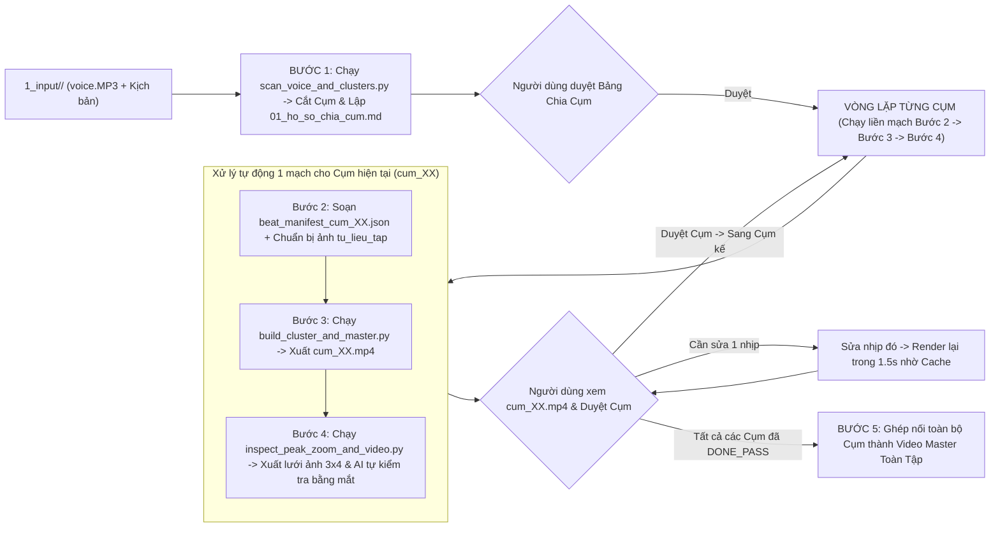

# 🎬 `2D-Illustrated-History` (`v1.0`) — Hệ Thống Sản Xuất Video Lịch Sử Hoạt Hình 2D Phong Cách Ziro

[](#)
[](#)
[](#)

Hệ thống tự động hóa sản xuất **Video Lịch Sử & Địa Chính Trị Hoạt Hình 2D Phong Cách Ziro (`1920x1080 @ 30fps`)** — vận hành bằng AI Skill [`.agent/skills/dung-video-lich-su-hoat-hinh-2d`](.agent/skills/dung-video-lich-su-hoat-hinh-2d/SKILL.md) theo kiến trúc **Vòng Lặp Cuốn Chiếu Từng Cụm (Iterative Cluster Loop)**, kết hợp **Sân khấu phẳng `#CCCCCC`**, **Chữ động không khung (Frameless Kinetic Typography)**, **Máy quay 2-Pass Chống Giật**, và **Bộ nhớ đệm Hash-Based Beat-Level MP4 Cache (`1.5s`)**.

---

## ✨ Điểm Khác Biệt Cốt Lõi Của Phiên Bản `v1.0`

1. **Bước 1 — Đồng Bộ Giọng Đọc & Cắt Cụm Chính Xác Tuyệt Đối (`scan_voice_and_clusters.py`)**:
   - Bóc tách mốc thời gian từng từ (`word_timestamps.json`) từ file thu âm `voice.MP3` bằng `faster-whisper`.
   - Khớp biên giới câu văn giữa kịch bản chữ (`kich_ban_chia_hoi.txt`) và chuỗi từ thu âm bằng thuật toán **Fuzzy Sentence-Boundary Alignment (`difflib.SequenceMatcher` + khử dấu tiếng Việt)** kết hợp tìm **Thung lũng im lặng (`Silence Valley` `< -38dB`)** để cắt lát từng Cụm (`voice_<cluster_id>.wav`) không mất chữ và không tràn sang Hồi sau.
2. **Bước 2 — Thiết Kế Hồ Sơ Nhịp Cảnh (`beat_manifest_<cluster_id>.json`)**:
   - Chuyển hóa lời dẫn lịch sử thành 13 khuôn mẫu sân khấu 2D Ziro (`T01..T08` cho Hồi phân tích, `S01..S05` cho Skit châm biếm).
   - Khóa chặt thời điểm xuất hiện của từng vế câu, mũi tên, con số và đạo cụ vào đúng giây phát âm thực tế thông qua mảng `sub_triggers_bt`.
3. **Bước 3 — Kết Xuất Video Cụm Siêu Tốc & Đồng Bộ Khẩu Hình (`build_cluster_and_master.py`)**:
   - **2-Pass Camera Rendering**: Vẽ toàn bộ nhân vật, đạo cụ, chữ động trên tấm toan gốc `1920x1080` trước, sau đó mới cắt khung máy quay (`Viewport Crop & Lanczos Resize`) giúp triệt tiêu 100% lỗi trôi lề hay lệch tọa độ khi zoom/pan.
   - **Audio RMS Lip-Sync 30fps**: Miệng nhân vật tự động đóng/mở (`closed`, `half`, `open`, `wide`) khớp theo biên độ âm lượng thực tế của giọng đọc.
   - **3-Layer Audio Mixer**: Tự động trộn Giọng đọc (`0 dBFS`) + Tiếng động SFX theo sự kiện hình ảnh (`-10 dBFS`) + Nhạc nền BGM tự động hạ âm lượng khi có giọng nói (`-22 dBFS`).
   - **Hash-Based Beat-Level MP4 Cache**: Băm mã `MD5` cho từng nhịp (`beat_XX_<hash8>.mp4`). Khi chỉnh sửa 1 nhịp bất kỳ, hệ thống chỉ vẽ lại đúng nhịp đó và nối lại toàn Cụm bằng `ffmpeg -c copy` trong **1.5 giây**.
4. **Bước 4 — Hậu Kiểm Thị Giác 8 Cổng & Bảng Ảnh Peak-Zoom 3x4 (`inspect_peak_zoom_and_video.py`)**:
   - Trích xuất 12 khung hình ngay tại đỉnh phóng đại (`Peak-Zoom`) từ chính file MP4 vừa xuất, đóng thành bảng ảnh kiểm duyệt `verify_peak_zoom_<cluster_id>.png` để AI và Người dùng kiểm tra bằng mắt thật trước khi chuyển sang Cụm tiếp theo.

---

## 📂 Cấu Trúc Thư Mục Chi Tiết Toàn Hệ Thống

```text
2D-Illustrated-History/
├── README.md                                        # Sổ tay hướng dẫn vận hành, bảo trì & bàn giao hệ thống (Bản v1.0)
├── .gitignore                                       # Cấu hình loại trừ file video/audio nặng khi đồng bộ GitHub
│
├── .agent/skills/dung-video-lich-su-hoat-hinh-2d/   # [BỘ NÃO SKILL AI] — Nơi chứa toàn bộ Tư duy, Luật & Code Engine
│   ├── SKILL.md                                     # Tệp điều phối chính: Quy trình 5 Bước, 5 Cổng dừng & Lệnh CLI
│   ├── config/
│   │   └── pipeline_thresholds.json                 # Tham số kỹ thuật: độ phân giải, FPS, ngưỡng âm thanh, màu sắc chuẩn
│   ├── references/                                  # Kho kiến thức & Tư duy đạo diễn (AI đọc để sáng tạo)
│   │   ├── core/
│   │   │   ├── 01_brand_system_va_spec_ziro.md      # Hiến pháp thị giác Ziro (Nền #CCCCCC, chữ không khung, nhân vật 70%)
│   │   │   ├── 02_camera_2pass_va_motion_doctrine.md# Luật máy quay 2-Pass, chuyển động lò xo & cô lập khung hình
│   │   │   └── 03_audio_3layer_va_lipsync_rms.md    # Luật âm thanh 3 lớp (Voice + SFX + BGM Ducking) & nhép miệng
│   │   ├── types/
│   │   │   ├── 01_khuon_mau_canh_hoi_phan_tich.md   # 8 khuôn mẫu cảnh cho Hồi phân tích lịch sử (T01 -> T08)
│   │   │   ├── 02_khuon_mau_canh_skit_cham_biem.md  # 5 khuôn mẫu cảnh cho Tiểu phẩm châm biếm (S01 -> S05)
│   │   │   └── 03_tu_duy_an_du_va_sang_tao_chong_lap.md # Công thức chuyển lời dẫn thành ẩn dụ vật lý & chống lặp cảnh
│   │   └── qa/
│   │       └── 01_tam_cong_kiem_duyet_thi_giac.md   # Tiêu chuẩn 8 cổng kiểm duyệt chất lượng (G1 -> G8)
│   ├── templates/                                   # Khuôn mẫu hồ sơ & cấu trúc JSON chuẩn
│   │   ├── 01_ho_so_chia_cum_va_bible_tap.md        # Mẫu bảng trạng thái theo dõi tiến độ các Cụm trong Tập
│   │   ├── 02_beat_manifest.schema.json             # Khuôn mẫu cấu trúc file kịch bản nhịp (beat_manifest.json)
│   │   └── 03_bien_ban_nghiem_thu_8_cong_qa.md      # Mẫu biên bản nghiệm thu chất lượng từng Cụm
│   └── scripts/                                     # Các bộ máy Python tự động hóa
│       ├── scanners/
│       │   └── scan_voice_and_clusters.py           # [Máy Bước 1] Quét voice.MP3, lấy mốc từng từ & cắt Cụm âm thanh
│       ├── engines/
│       │   ├── ziro_stage_components.py             # [Thư viện Đồ họa] Vẽ nhân vật 2D, bản đồ, đạo cụ, chữ động
│       │   ├── camera_2pass_renderer.py             # [Máy Quay 2-Pass] Nội suy đường cong zoom/pan & cắt khung hình
│       │   ├── audio_3layer_mixer.py                # [Bàn Trộn Âm Thanh] Trộn 3 lớp Voice + SFX + BGM Ducking & RMS
│       │   └── build_cluster_and_master.py          # [Máy Bước 3 & 5] Kết xuất MP4 từng Cụm (có Cache) & ghép Tập
│       └── validators/
│           ├── validate_skill_structure.py          # [Máy Kiểm Định] Kiểm tra cấu trúc Skill & cú pháp toàn bộ code
│           ├── validate_beat_manifest.py            # [Máy Kiểm Định Bước 2] Kiểm tra cấu trúc JSON & chống lặp cảnh
│           └── inspect_peak_zoom_and_video.py       # [Máy Bước 4] Chụp 12 ảnh Peak-Zoom từ MP4 & lập biên bản QA
│
└── Du-an-2D-Illustrated-History/                    # [KHÔNG GIAN SẢN XUẤT DỰ ÁN]
    ├── 00_TU_DUY_QUY_TRINH_VA_GU_EDIT/              # Tài liệu phân tích mẫu & cẩm nang quy chuẩn gốc của kênh
    └── dung-video-lich-su-hoat-hinh-2d/             # Thư mục làm việc chính của các Tập phim (Workspace)
        ├── 1_input/<Ma_Tap>/                        # [ĐẦU VÀO — DO NGƯỜI DÙNG CUNG CẤP]
        │   ├── voice.MP3                            # File thu âm giọng đọc toàn tập
        │   ├── kich_ban_chia_hoi.txt                # Kịch bản có đánh dấu các Hồi và các Skit
        │   ├── kich_ban_loi_dan.txt                 # Văn bản lời dẫn thuần túy khớp với voice.MP3
        │   └── tu_lieu_tap/                         # Kho ảnh tư liệu, bản đồ, đạo cụ minh họa của tập
        ├── 2_nguyen_lieu/<Ma_Tap>/                  # [NGUYÊN LIỆU TRUNG GIAN — DO AI TỰ TẠO & QUẢN LÝ]
        │   ├── 01_ho_so_chia_cum.md                 # Bảng theo dõi trạng thái từng Cụm (PENDING / DONE_PASS)
        │   ├── word_timestamps.json                 # Mốc thời gian từng từ bóc tách từ voice.MP3
        │   └── cac_cum/<cluster_id>/                # Hồ sơ riêng của từng Cụm (vd: cum_01_Hoi_I)
        │       ├── voice_<cluster_id>.wav           # Đoạn âm thanh giọng đọc đã cắt riêng cho Cụm
        │       ├── beat_manifest_<cluster_id>.json  # Kịch bản đạo diễn chi tiết từng nhịp của Cụm
        │       ├── 03_bien_ban_qa_<cluster_id>.md   # Biên bản nghiệm thu 8 cổng của Cụm
        │       └── cache_beats/                     # Bộ nhớ đệm các đoạn video nhịp (beat_XX_<hash>.mp4)
        └── 3_output/<Ma_Tap>/                       # [ĐẦU RA THÀNH PHẨM — NƠI NGƯỜI DÙNG LẤY KẾT QUẢ]
            ├── 1_video_cac_cum/                     # Chứa các file video từng Cụm (vd: cum_01_Hoi_I.mp4)
            ├── 2_bang_kiem_duyet_qa/                # Chứa bảng ảnh kiểm duyệt 3x4 (verify_peak_zoom_<cluster_id>.png)
            └── 3_video_master_full/                 # Chứa video hoàn chỉnh cả Tập sau khi ghép nối
```

---

## 🔄 Quy Trình Vận Hành Vòng Lặp Từng Cụm (Iterative Cluster Workflow)

Hệ thống **không dựng một lèo cả tập 20 phút** (dễ sai sót và khó kiểm soát), mà chia mỗi Tập thành các **Cụm (Hồi phân tích / Skit châm biếm)** dài khoảng `60s – 180s` và xử lý cuốn chiếu:



---

## 🛠️ Cẩm Nang Bảo Trì: Khi Sai Sót Hoặc Muốn Bổ Sung Tư Duy Thì Sửa Ở Đâu?

| Tình huống thực tế phát sinh | File cần mở để chỉnh sửa | Cách điều chỉnh & Lưu ý quan trọng |
| :--- | :--- | :--- |
| **1. Muốn bổ sung thêm "Tư duy ẩn dụ hình ảnh mới" hoặc quy tắc sáng tạo mới cho Tập 2, Tập 3** | [`.agent/skills/dung-video-lich-su-hoat-hinh-2d/references/types/03_tu_duy_an_du_va_sang_tao_chong_lap.md`](.agent/skills/dung-video-lich-su-hoat-hinh-2d/references/types/03_tu_duy_an_du_va_sang_tao_chong_lap.md) | Viết thêm quy tắc hoặc ví dụ chuyển đổi từ câu văn trừu tượng sang hình ảnh vật lý vào file Markdown này. Không cần sửa code Python nếu dùng các thành phần đồ họa đã có. |
| **2. Muốn thêm Khuôn mẫu cảnh mới cho Hồi phân tích hoặc Skit** | [`.agent/skills/dung-video-lich-su-hoat-hinh-2d/references/types/01_khuon_mau_canh_hoi_phan_tich.md`](.agent/skills/dung-video-lich-su-hoat-hinh-2d/references/types/01_khuon_mau_canh_hoi_phan_tich.md) hoặc [`02_khuon_mau_canh_skit_cham_biem.md`](.agent/skills/dung-video-lich-su-hoat-hinh-2d/references/types/02_khuon_mau_canh_skit_cham_biem.md) | Mô tả bố cục khuôn mẫu mới ở file `.md`, đồng thời bổ sung hàm vẽ tương ứng trong [`scripts/engines/ziro_stage_components.py`](.agent/skills/dung-video-lich-su-hoat-hinh-2d/scripts/engines/ziro_stage_components.py). |
| **3. Chữ, mũi tên hoặc khoanh vùng bản đồ ở 1 nhịp cụ thể bị lệch vị trí hoặc hiện sớm/muộn hơn giọng đọc** | `2_nguyen_lieu/<Ma_Tap>/cac_cum/<cluster_id>/beat_manifest_<cluster_id>.json` | Mở file JSON của Cụm đó, chỉnh lại mảng `sub_triggers_bt` (giây xuất hiện phần tử con) hoặc tọa độ `camera_pan`, sau đó chạy lại lệnh Bước 3 (nhờ Cache chỉ mất `1.5s`). |
| **4. Muốn đổi màu nền chuẩn, cỡ chữ, hoặc âm lượng nhạc nền / SFX toàn kênh** | [`.agent/skills/dung-video-lich-su-hoat-hinh-2d/config/pipeline_thresholds.json`](.agent/skills/dung-video-lich-su-hoat-hinh-2d/config/pipeline_thresholds.json) | Chỉnh thông số trong file JSON cấu hình và hàm `MixAudio3Layer` trong [`scripts/engines/build_cluster_and_master.py`](.agent/skills/dung-video-lich-su-hoat-hinh-2d/scripts/engines/build_cluster_and_master.py). |
| **5. Điểm cắt giữa các Hồi/Cụm bị lệch vài giây so với giọng đọc** | `2_nguyen_lieu/<Ma_Tap>/01_ho_so_chia_cum.md` hoặc [`scripts/scanners/scan_voice_and_clusters.py`](.agent/skills/dung-video-lich-su-hoat-hinh-2d/scripts/scanners/scan_voice_and_clusters.py) | Đảm bảo câu đầu tiên của mỗi Hồi trong `kich_ban_chia_hoi.txt` khớp với câu phát âm trong `voice.MP3`. |

### ⚠️ 4 Điều Cấm Kỵ Cần Tránh Khi Vận Hành & Chỉnh Sửa
1. **Không đóng khung chữ (Zero Text-Box Rule):** Phong cách Ziro dùng chữ trần không khung đè trực tiếp lên nền `#CCCCCC`. Chỉ con dấu đóng mộc (`STAMP <10%`) mới có viền.
2. **Không cắt ngang chữ khi chuyển nhịp:** Luôn đặt điểm chuyển nhịp (`start_sec` / `end_sec`) trùng với khe nghỉ giữa hai câu trong `word_timestamps.json`.
3. **Không xóa thư mục `cache_beats/` khi đang tinh chỉnh Cụm:** Giữ nguyên `cache_beats/` giúp tốc độ sửa 1 nhịp chỉ mất `1.5s` thay vì phải render lại từ đầu.
4. **Luôn đồng bộ 2 thư mục Skill:** Khi cập nhật bất kỳ file nào trong `.agent/skills/dung-video-lich-su-hoat-hinh-2d/`, hãy copy đồng bộ sang `Du-an-2D-Illustrated-History/dung-video-lich-su-hoat-hinh-2d/` và chạy `validate_skill_structure.py` để kiểm tra.

---

## 🤝 Hướng Dẫn Bàn Giao & Câu Lệnh Vận Hành Nhanh

### 1. Khi bàn giao cho nhân sự / Editor mới:
Nhân sự mới chỉ cần chuẩn bị đủ **4 mục đầu vào** bỏ vào `Du-an-2D-Illustrated-History/dung-video-lich-su-hoat-hinh-2d/1_input/<Ma_Tap_Moi>/`:
1. `voice.MP3` (File thu âm giọng đọc toàn tập).
2. `kich_ban_chia_hoi.txt` (Kịch bản có chia Hồi I, Skit 1, Hồi II...).
3. `kich_ban_loi_dan.txt` (Lời dẫn văn bản thuần túy).
4. `tu_lieu_tap/` (Thư mục chứa các ảnh tư liệu/bản đồ theo từng cụm).

### 2. Câu lệnh giao việc cho AI trong khung Chat:
* **Khởi chạy Tập mới:**
  > *"Hãy đọc Skill `@[.agent/skills/dung-video-lich-su-hoat-hinh-2d/SKILL.md]` và chạy Bước 1 cho tập `EP02_...` trong thư mục `1_input/EP02_...`, sau đó báo cáo bảng chia cụm cho tôi duyệt."*
* **Chạy vòng lặp sản xuất Cụm (1 mạch từ Bước 2 $\rightarrow$ Bước 4):**
  > *"Hãy thực hiện vòng lặp sản xuất cho `cum_02_Skit_1` của tập `EP01_Iran`: chạy liền mạch từ Bước 2 đến Bước 4, tự kiểm tra bằng mắt bảng ảnh Peak-Zoom 3x4 rồi gửi video MP4 hoàn chỉnh cho tôi duyệt."*

### 3. Chạy trực tiếp bằng Dòng lệnh (CLI):
```powershell
# Kiểm định cấu trúc Skill (Bắt buộc đạt PASS 100%)
python ".agent/skills/dung-video-lich-su-hoat-hinh-2d/scripts/validators/validate_skill_structure.py" --skill-dir ".agent/skills/dung-video-lich-su-hoat-hinh-2d"

# Bước 1: Quét voice.MP3 & cắt Cụm theo biên giới câu văn
python ".agent/skills/dung-video-lich-su-hoat-hinh-2d/scripts/scanners/scan_voice_and_clusters.py" --workspace "Du-an-2D-Illustrated-History/dung-video-lich-su-hoat-hinh-2d" --ep "EP01_Iran"

# Bước 3: Render MP4 Cụm (kích hoạt bộ nhớ đệm Beat-Level Cache 1.5s)
python ".agent/skills/dung-video-lich-su-hoat-hinh-2d/scripts/engines/build_cluster_and_master.py" --workspace "Du-an-2D-Illustrated-History/dung-video-lich-su-hoat-hinh-2d" --ep "EP01_Iran" --mode cluster --cluster-id "cum_01_Hoi_I"

# Bước 4: Hậu kiểm 12 khung hình Peak-Zoom & xuất lưới ảnh 3x4
python ".agent/skills/dung-video-lich-su-hoat-hinh-2d/scripts/validators/inspect_peak_zoom_and_video.py" --workspace "Du-an-2D-Illustrated-History/dung-video-lich-su-hoat-hinh-2d" --ep "EP01_Iran" --cluster-id "cum_01_Hoi_I" --update-status "DONE_PASS"
```
