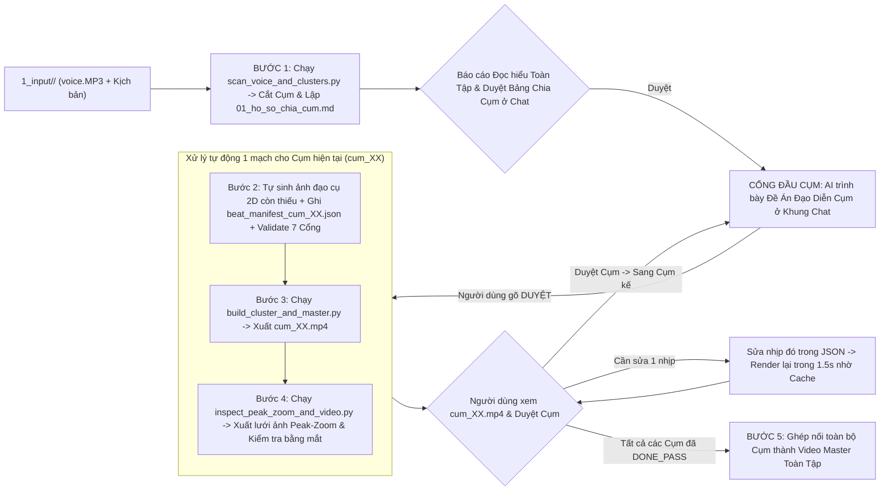

# 🎬 `2D-Illustrated-History` (`v2.0`) — Hệ Thống Sản Xuất Video Lịch Sử Hoạt Hình 2D Chuẩn Ziro History

[](#)
[](#)
[](#)

Hệ thống tự động hóa sản xuất **Video Lịch Sử & Địa Chính Trị Hoạt Hình 2D Phong Cách Ziro (`1920x1080 @ 30fps`)** — vận hành bằng AI Skill [`.agent/skills/dung-video-lich-su-hoat-hinh-2d`](.agent/skills/dung-video-lich-su-hoat-hinh-2d/SKILL.md) theo kiến trúc **Vòng Lặp Cuốn Chiếu Từng Cụm (`Iterative Cluster Loop`)**, kết hợp **Sân khấu phẳng `#CCCCCC`**, **Engine Skit 2 Nhân vật Toàn Sân Khấu (`Two-Actor Full-Stage Sitcom`)**, **Chữ thoại trên đầu làm mờ `38%` theo lượt thoại**, **Cử động nhân vật vi mô (`Chớp mắt 3.1s / Đổi tay / Bước đi`)**, **5 Đường nét chuyển động 2D**, và **Kho 8 Tiếng động gốc Ziro History (`ziro_authentic_sfx`)**.

---

## 🚀 5 Đột Phá Mới Trong Phiên Bản `v2.0` (`V2` — Chuẩn `02:10 / 05:00 / 13:56` Ziro History)

1. **Engine Skit 2 Nhân Vật Toàn Sân Khấu (`Two-Actor Full-Stage Sitcom` — `skit_stage_bg`)**:
   - Dựng trực tiếp 6 bối cảnh hoạt hình 2D toàn màn hình (`PERSIAN_COMMAND_TENT`, `THERMOPYLAE_MAP_DESK`, `SPARTAN_STAGE_SPOTLIGHT`, `GREEK_HISTORIAN_STUDY`, `HOLLYWOOD_VS_REALITY_STAGE`, `PERSIAN_TENT_TO_MODERN_CINEMA`) dựa trên giải phẫu cảnh `02:10` (Hang động), `05:00` (Lều tướng Nhà Tùy & Sử gia), và `13:56` (Bàn bản đồ vĩ tuyến 38) của Ziro History.
   - Tuyệt đối không thả thẻ ảnh tư liệu viền trắng (`Archival Photo Card`) đè lên cảnh đối thoại của 2 nhân vật trong Skit.
2. **Chữ Thoại Trên Đầu Nhân Vật & Làm Mờ `38%` Theo Lượt Thoại (`skit_speech_captions` & `Zero HUD`)**:
   - Trong các Cụm Skit (`SKIT_CHAM_BIEM`), tự động tắt tiêu đề đỉnh HUD (`hud_banner.style = "NONE"`) và ẩn nhãn tên dưới chân (`hide_label: true`).
   - Đặt câu thoại viết hoa/thường tự nhiên (Sentence case, chia 2–3 dòng) ngay trên đầu người nói kèm vạch chỉ ngắn `14px` (`show_tick: true`).
   - Khi Nhân vật B đáp lời, câu nói của Nhân vật A **không biến mất hoàn toàn mà tự động hạ độ đậm xuống `38%` (`opacity: 0.38`)** làm nền đối chiếu hài hước.
3. **Cử Động Nhân Vật Vi Mô (`Micro-Life Character Rig`)**:
   - Tự động **chớp mắt chu kỳ `3.1s` một lần** (`blink = True`, lệch pha giữa các nhân vật), nhún nhịp thở `2.5px` khi đang thoại, **bước đi sải chân ngang sân khấu** (`walk_vx`, `walk_start_bt`), và **đổi tư thế tay/biểu cảm ngay giữa nhịp** (`pose_swap_bt`, `swap_left_arm`, `swap_right_arm`, `swap_emotion`).
4. **Bộ 5 Đường Nét Chuyển Động Vector 2D (`5 Animated Vector Primitives`)**:
   - `live_pencil_line`: Cây bút chì gỗ vàng 2D có đầu tẩy hồng tự động vẽ đường tiến quân liền hoặc nét đứt trên mặt bàn bản đồ.
   - `wavy_steam_lines`: 3 đường sóng hương thơm/khói hình sin uốn lượn bay lên liên tục.
   - `sparkle_bursts`: Các ngôi sao 4 cánh `✦` co giãn lấp lánh quanh đạo cụ hoặc nhân vật.
   - `live_quill_scroll`: Cuộn giấy da dê tự mở kèm cây bút lông ngỗng 2D tự động lướt viết từng dòng, gạch đỏ số cũ và bật chữ phóng đại.
   - `live_ruler_measure` & `checklist_board`: Thước đo chiều cao tự động rút từ `0.0m -> 3.0m` và bảng kiểm tự động tích xanh `[✓]` theo giọng đọc.
5. **Kho 8 Tiếng Động Gốc Ziro History (`ziro_authentic_sfx`) & Bàn Trộn Hạ Mượt Âm Lượng**:
   - Đóng gói sẵn 8 file WAV gốc trích xuất từ Ziro History (`ziro_pop_soft.wav`, `ziro_scroll_unroll.wav`, `ziro_rubber_stamp.wav`, `ziro_icon_pop_rapid.wav`, `ziro_spear_drop.wav`, `ziro_padlock_slam.wav`, `ziro_light_off_thud.wav`, `ziro_poem_unroll.wav`) ngay trong kho tự chủ `.agent/skills/dung-video-lich-su-hoat-hinh-2d/kho_rieng_2d_history_va_opus5_5/ziro_authentic_sfx/`.
   - Hạ mức trộn SFX mặc định xuống **`-14.5 dB`** (RMS thực tế đạt `-28` đến `-35 dBFS`, thấp hơn giọng đọc `13–18 dB`) và tự động hạ nhạc nền BGM mượt mà ở **`-20.0 dB` (khi có giọng nói) / `-12.5 dB` (khi nghỉ)**.

---

## ✨ Nền Tảng Cốt Lõi Từ Phiên Bản `v1.0`

1. **Bước 1 — Đồng Bộ Giọng Đọc & Cắt Cụm Chính Xác Tuyệt Đối (`scan_voice_and_clusters.py`)**:
   - Bóc tách mốc thời gian từng từ (`word_timestamps.json`) từ file thu âm `voice.MP3` bằng `faster-whisper`.
   - Khớp biên giới câu văn giữa kịch bản chữ (`kich_ban_chia_hoi.txt`) và chuỗi từ thu âm bằng thuật toán **Fuzzy Sentence-Boundary Alignment (`difflib.SequenceMatcher` + khử dấu tiếng Việt)** kết hợp tìm **Thung lũng im lặng (`Silence Valley` `< -38dB`)** để cắt lát từng Cụm (`voice_<cluster_id>.wav`) không mất chữ và không tràn sang Hồi sau.
2. **Bước 2 — Thiết Kế Hồ Sơ Nhịp Cảnh (`beat_manifest_<cluster_id>.json`)**:
   - Chuyển hóa lời dẫn lịch sử thành 13 khuôn mẫu sân khấu 2D Ziro (`T01..T08` cho Hồi phân tích, `S01..S05` & `skit_stage_bg` cho Skit châm biếm).
   - Khóa chặt thời điểm xuất hiện của từng vế câu, mũi tên, con số và đạo cụ vào đúng giây phát âm thực tế thông qua mảng `sub_triggers_bt` và `custom_scene_graph`.
3. **Bước 3 — Kết Xuất Video Cụm Siêu Tốc & Đồng Bộ Khẩu Hình (`build_cluster_and_master.py`)**:
   - **2-Pass Camera Rendering**: Vẽ toàn bộ nhân vật, đạo cụ, chữ động trên tấm toan gốc `1920x1080` trước (`Pass 1`), sau đó áp dụng máy quay (`Viewport Crop & Lanczos Resize`) rồi mới phủ lớp tiêu đề `Pass 2` giúp triệt tiêu 100% lỗi cắt chữ.
   - **Hash-Based Beat-Level MP4 Cache**: Băm mã `MD5` cho từng nhịp (`beat_XX_<hash8>.mp4`). Khi chỉnh sửa 1 nhịp bất kỳ, hệ thống chỉ vẽ lại đúng nhịp đó và nối lại toàn Cụm bằng `ffmpeg -c copy` trong **1.5 giây**.
4. **Bước 4 — Hậu Kiểm Thị Giác 8 Cổng & Bảng Ảnh Peak-Zoom (`inspect_peak_zoom_and_video.py`)**:
   - Trích xuất khung hình ngay tại đỉnh phóng đại (`Peak-Zoom`) từ chính file MP4 vừa xuất, đóng thành bảng ảnh kiểm duyệt `verify_peak_zoom_<cluster_id>.png` để AI và Người dùng kiểm tra bằng mắt thật trước khi chuyển sang Cụm tiếp theo.

---

## 📂 Cấu Trúc Thư Mục Chi Tiết Toàn Hệ Thống (`v2.0`)

```text
2D-Illustrated-History/
├── README.md                                        # Sổ tay hướng dẫn vận hành, bảo trì & bàn giao hệ thống (Bản v2.0)
├── .gitignore                                       # Cấu hình loại trừ file video/audio nặng (giữ lại ziro_authentic_sfx)
│
├── .agent/skills/dung-video-lich-su-hoat-hinh-2d/   # [BỘ NÃO SKILL AI TỰ CHỦ 100%] — Tư duy, Luật, Code Engine & Kho SFX gốc
│   ├── SKILL.md                                     # Tệp điều phối chính (<150 dòng, lệnh đọc phẫu thuật StartLine->EndLine)
│   ├── config/
│   │   └── ziro_brand_tokens.json                   # Tham số kỹ thuật: độ phân giải, FPS, ngưỡng âm thanh, màu sắc chuẩn
│   ├── kho_rieng_2d_history_va_opus5_5/             # [PHÁO ĐÀI TỰ CHỦ] Chứa bộ 8 file WAV SFX gốc của Ziro History
│   │   └── ziro_authentic_sfx/*.wav                 # 8 file SFX gốc (ziro_pop_soft, ziro_scroll_unroll, ziro_rubber_stamp...)
│   ├── references/                                  # Kho kiến thức & Tư duy đạo diễn (9 file Markdown ruột đặc)
│   │   ├── core/
│   │   │   ├── 01_brand_system_va_spec_ziro.md
│   │   │   ├── 02_character_anatomy_va_lego_components.md # Giải phẫu nhân vật, Chớp mắt/Đổi tay/Bước đi & 5 Đường nét Vector
│   │   │   ├── 03_voice_0ms_lock_va_chia_cum_30p.md
│   │   │   ├── 04_camera_2pass_va_motion_physics.md
│   │   │   ├── 05_sound_design_3layer_sfx_bgm.md    # Thiết kế âm thanh 3 lớp & Từ điển 8 SFX gốc Ziro (-14.5dB)
│   │   │   └── 06_review_peak_zoom_va_p0_p1_qa.md
│   │   └── types/
│   │       ├── 01_khuon_mau_canh_hoi_phan_tich.md   # 8 khuôn mẫu cảnh cho Hồi phân tích lịch sử (T01 -> T08)
│   │       ├── 02_khuon_mau_canh_skit_cham_biem.md  # 6 sân khấu Skit 2 nhân vật (skit_stage_bg) & Thoại trên đầu làm mờ 38%
│   │       └── 03_tu_duy_an_du_va_sang_tao_chong_lap.md # Công thức chuyển lời dẫn thành ẩn dụ vật lý & 7 Viên Gạch Nguyên Tử
│   ├── templates/                                   # Khuôn mẫu hồ sơ & cấu trúc JSON chuẩn
│   │   ├── 01_ho_so_chia_cum_va_bible_tap.md
│   │   ├── 02_beat_manifest.schema.json             # Schema kiểm toán kịch bản nhịp (hỗ trợ skit_stage_bg & ziro_authentic_sfx)
│   │   └── 03_bien_ban_nghiem_thu_8_cong_qa.md
│   └── scripts/                                     # Các bộ máy Python tự động hóa
│       ├── scanners/
│       │   └── scan_voice_and_clusters.py           # [Máy Bước 1] Quét voice.MP3, lấy mốc từng từ & cắt Cụm âm thanh
│       ├── engines/
│       │   ├── ziro_stage_components.py             # [Thư viện Đồ họa v2.0] Vẽ Skit 2 nhân vật, 5 đường nét vector, chớp mắt/bước đi
│       │   ├── camera_2pass_renderer.py             # [Máy Quay 2-Pass] Nội suy đường cong zoom/pan & cô lập khung hình
│       │   ├── audio_3layer_mixer.py                # [Bàn Trộn Âm Thanh v2.0] Đồng bộ 8 SFX gốc Ziro (-14.5dB) & BGM Ducking
│       │   └── build_cluster_and_master.py          # [Máy Bước 3 & 5] Kết xuất MP4 từng Cụm (có Cache) & ghép Tập
│       └── validators/
│           ├── validate_skill_structure.py          # [Máy Kiểm Định Skill] Kiểm tra cấu trúc Skill & tính tự chủ 100%
│           ├── validate_beat_manifest.py            # [Máy Kiểm Định Bước 2] Kiểm tra 7 cổng toán học & luật Skit
│           └── inspect_peak_zoom_and_video.py       # [Máy Bước 4] Chụp lưới ảnh Peak-Zoom từ MP4 & lập biên bản QA
│
└── Du-an-2D-Illustrated-History/                    # [KHÔNG GIAN SẢN XUẤT DỰ ÁN]
    ├── 00_TU_DUY_QUY_TRINH_VA_GU_EDIT/              # Tài liệu phân tích mẫu & cẩm nang quy chuẩn gốc của kênh
    └── dung-video-lich-su-hoat-hinh-2d/             # Thư mục làm việc chính của các Tập phim (Workspace)
        ├── 1_input/<Ma_Tap>/                        # [ĐẦU VÀO — DO NGƯỜI DÙNG CUNG CẤP]
        ├── 2_nguyen_lieu/<Ma_Tap>/                  # [NGUYÊN LIỆU TRUNG GIAN — DO AI TỰ TẠO & QUẢN LÝ]
        └── 3_output/<Ma_Tap>/                       # [ĐẦU RA THÀNH PHẨM — NƠI NGƯỜI DÙNG LẤY KẾT QUẢ]
```

---

## 🔄 Quy Trình Vận Hành Vòng Lặp Từng Cụm (`Iterative Cluster Workflow`)



---

## 💻 Câu Lệnh Vận Hành Nhanh (`CLI Commands`)

```powershell
# 1. Kiểm định cấu trúc Skill (Bắt buộc đạt PASS 100%)
python ".agent/skills/dung-video-lich-su-hoat-hinh-2d/scripts/validators/validate_skill_structure.py" ".agent/skills/dung-video-lich-su-hoat-hinh-2d"

# 2. Kiểm định kịch bản nhịp Beat Manifest JSON (7 Cổng toán học & Luật Skit)
python ".agent/skills/dung-video-lich-su-hoat-hinh-2d/scripts/validators/validate_beat_manifest.py" "Du-an-2D-Illustrated-History/dung-video-lich-su-hoat-hinh-2d/2_nguyen_lieu/EP01_Iran/cac_cum/cum_03_Skit_1/beat_manifest_cum_03_Skit_1.json"

# 3. Render MP4 Cụm (kích hoạt bộ nhớ đệm Beat-Level Cache 1.5s & Bộ trộn 3 lớp SFX gốc Ziro)
python ".agent/skills/dung-video-lich-su-hoat-hinh-2d/scripts/engines/build_cluster_and_master.py" "Du-an-2D-Illustrated-History/dung-video-lich-su-hoat-hinh-2d/2_nguyen_lieu/EP01_Iran/cac_cum/cum_03_Skit_1/beat_manifest_cum_03_Skit_1.json"

# 4. Hậu kiểm khung hình Peak-Zoom & xuất lưới ảnh kiểm duyệt
python ".agent/skills/dung-video-lich-su-hoat-hinh-2d/scripts/validators/inspect_peak_zoom_and_video.py" "EP01_Iran" "cum_03_Skit_1"
```
